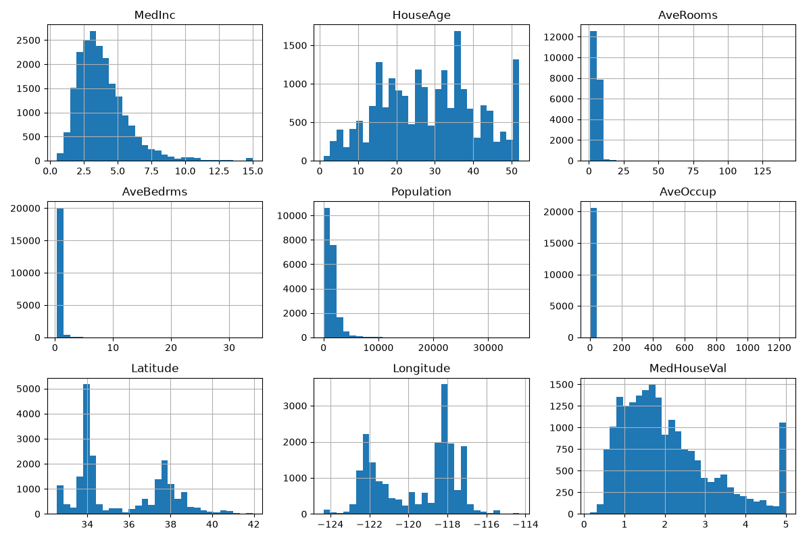
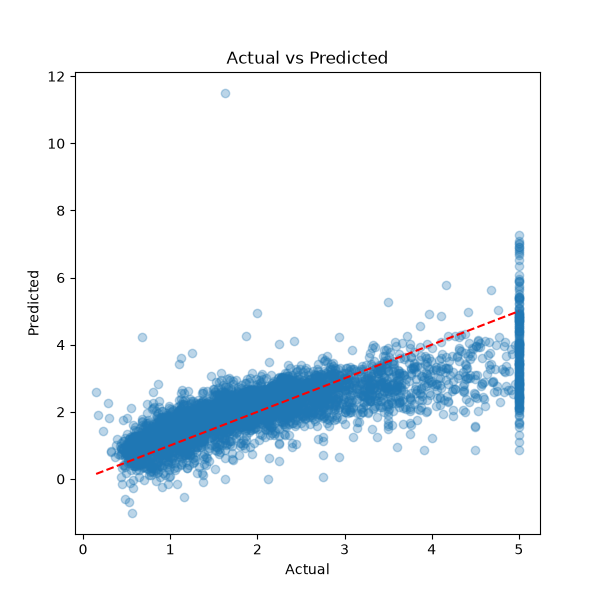
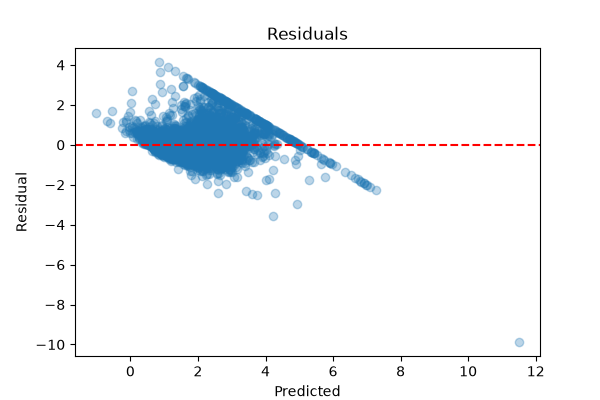
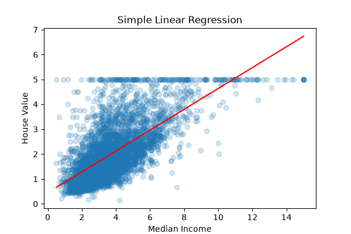

# Simple Linear Regression Model

A machine learning project that predicts a continuous target variable (median house value) from one or more input features using linear regression in Python.

## Description

This project implements a linear regression model with scikit-learn to predict house prices. It covers the full machine learning workflow: preparing data, preprocessing, building and training a model, evaluating it with standard metrics, and improving it using regularization and feature engineering.

## Technologies Used

- **Language:** Python 3
- **Libraries:** scikit-learn, NumPy, Pandas
- **Visualization:** Matplotlib
- **Dataset:** California Housing dataset (built into scikit-learn)

## Dataset

The **California Housing dataset** is used in this project.

> The Boston Housing dataset was removed from scikit-learn (version 1.2 onwards) due to ethical concerns about one of its features. The California Housing dataset was used instead. It is a standard regression dataset with continuous features and a continuous target, so it fits the project requirements.

| Property | Details |
|---|---|
| Source | 1990 U.S. Census data for California, loaded with `sklearn.datasets.fetch_california_housing` |
| Samples | 20,640 (each row is a census block group) |
| Features | 8 numeric input features |
| Target | `MedHouseVal`, the median house value in units of $100,000 |
| Missing values | None |

**Features**

| Feature | Description |
|---|---|
| `MedInc` | Median income in the block group |
| `HouseAge` | Median house age in the block group |
| `AveRooms` | Average number of rooms per household |
| `AveBedrms` | Average number of bedrooms per household |
| `Population` | Block group population |
| `AveOccup` | Average number of household members |
| `Latitude` | Block group latitude |
| `Longitude` | Block group longitude |

## Project Structure

```
linear-regression-project/
├── linear_regression_project.py   # main script
├── requirements.txt               # dependencies
├── README.md                      # project documentation
├── histograms.png                 # feature distributions
├── actual_vs_predicted.png        # model predictions vs true values
├── residuals.png                  # residual plot
└── simple_regression.png          # single-feature regression line
```

## Setup and Usage

```bash
# 1. Create and activate a virtual environment
python -m venv venv
venv\Scripts\activate          # Windows
source venv/bin/activate       # Mac/Linux

# 2. Install dependencies
pip install scikit-learn numpy pandas matplotlib

# 3. Run the project
python linear_regression_project.py
```

An internet connection is needed on the first run to download the dataset.

## Steps Followed

1. **Data collection/preparation:** Loaded the dataset into a Pandas DataFrame, inspected its shape, summary statistics and missing values, and checked each feature's correlation with the target.
2. **Data preprocessing:** Removed duplicates, handled missing values, split the data into 80% training and 20% testing sets, and scaled the features with `StandardScaler`. The scaler was fitted on the training data only to avoid data leakage.
3. **Model building:** Created a `LinearRegression` model using scikit-learn.
4. **Model training:** Trained the model on the training set with `model.fit(X_train_s, y_train)`.
5. **Model evaluation:** Evaluated the model on the test set using Mean Squared Error (MSE), Root Mean Squared Error (RMSE), Mean Absolute Error (MAE) and R-squared (R²). Also used 5-fold cross-validation, an actual vs predicted plot and a residual plot.
6. **Improvement (optional):** Compared Ridge and Lasso regularization and tried feature engineering (log transforms and a rooms-per-occupant ratio).

A single-feature model using only `MedInc` is also included to show a simple linear regression as a plotted line.

## Train/Test Split

The dataset has 20,640 rows, which were split into a training set and a testing set:

| Set | Rows | Share | Used for |
|---|---|---|---|
| Training | 16,512 | 80% | Training the model with `model.fit()` |
| Testing | 4,128 | 20% | Evaluating the model on data it has never seen |

The split was done with `train_test_split(X, y, test_size=0.2, random_state=42)`.

**Why keep a separate test set?** A model tested on the same rows it trained on would only show how well it memorized the data, and the scores would be too optimistic. Evaluating on unseen rows shows how well the model predicts new data, which is the purpose of the model. An 80/20 split is a standard choice: the model gets plenty of data to learn from (16,512 rows), and the test set is large enough to give a reliable score.

**Why `random_state=42`?** It fixes the random shuffling so the split is identical on every run, which makes the results reproducible.

Features were scaled with `StandardScaler`, fitted on the training data only and then applied to the test data, so no information from the test set leaks into training.


### Plots






## Results

| Model | MSE | RMSE | MAE | R² |
|---|---|---|---|---|
| Linear Regression | 0.5559 | 0.7456 | 0.5332 | 0.5758 |
| Ridge | 0.5559 | 0.7456 | 0.5332 | 0.5758 |
| Lasso | 0.5545 | 0.7446 | 0.5331 | 0.5769 |
| Linear + Feature Engineering | 0.4747 | 0.6890 | 0.4963 | 0.6378 |

- **5-fold cross-validation R²:** 0.5530 (+/- 0.0617)
- **Single-feature model (`MedInc`) R²:** 0.4589
- **Most influential feature (largest coefficient):** `Latitude` (-0.8969), followed by `Longitude` (-0.8698) and `MedInc` (0.8544)

## Conclusion

Linear regression gives a reasonable baseline for predicting house values, with an R² of about 0.58 on the test set. Ridge and Lasso gave almost the same scores as plain linear regression, because the dataset has few features and regularization has little to correct. Feature engineering (log transforms and a rooms-per-occupant ratio) gave the biggest improvement, raising R² to 0.6378 and lowering MSE from 0.5559 to 0.4747.

Median income (`MedInc`) is the strongest single predictor: it has the highest correlation with the target (0.688) and reaches R² = 0.4589 on its own. `Latitude` and `Longitude` have the largest coefficients, which reflects how strongly location affects house prices in California. Since a linear model still leaves a lot of variance unexplained, more flexible models such as decision trees or gradient boosting could improve performance further.

## Learning Outcomes

- **Understanding of linear regression concepts:** how a model fits a line (or hyperplane) to predict a continuous value, and how to read its coefficients and intercept.
- **Experience with scikit-learn:** used `LinearRegression`, `Ridge`, `Lasso`, `train_test_split`, `StandardScaler`, `cross_val_score` and the metrics module.
- **Data preprocessing techniques:** cleaning data, handling missing values, train/test splitting, feature scaling and avoiding data leakage.
- **Model training and evaluation:** training a model and evaluating it with MSE, RMSE, MAE and R², along with cross-validation and diagnostic plots.